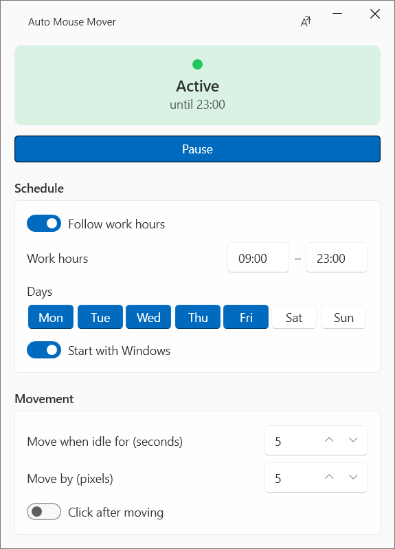
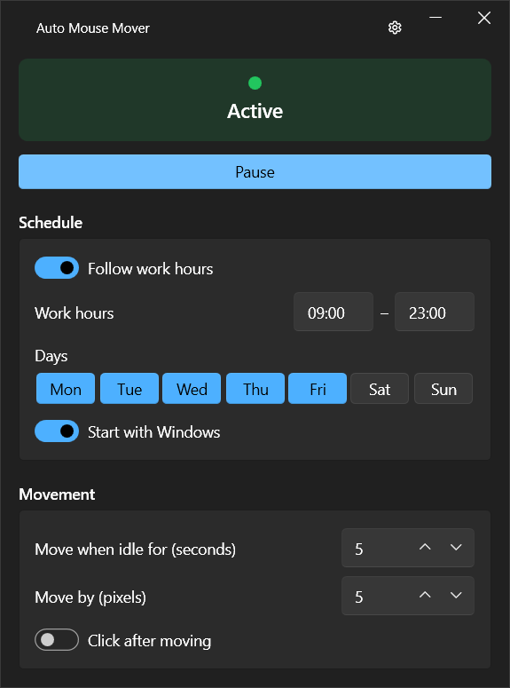
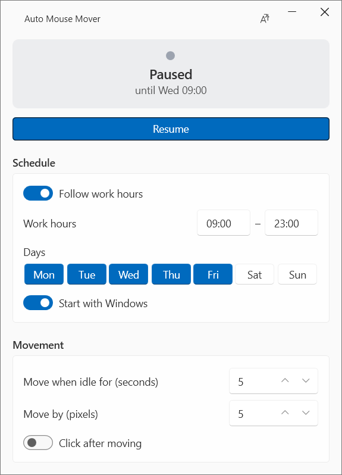

# Automatic Mouse Mover

[](LICENSE)
[](https://github.com/MohamedHamed001/auto_mouse_mover/releases/latest)

A small Windows and macOS app that keeps your computer "active" by nudging the mouse cursor while you're away: no screen lock, no "Away" status in Teams or Slack, and it never gets in your way while you're working.

<p align="center">
  
  &nbsp;
  
  &nbsp;
  
</p>

This is a fork of [ebellocchia/auto_mouse_mover](https://github.com/ebellocchia/auto_mouse_mover). Version 2.0 adds a new window, a work schedule and a tray menu; version 2.2 adds macOS.

## Features

- **Status at a glance:** a card shows whether the mouse is being moved right now and until when.
- **Work schedule:** starts by itself when your work hours begin and stops when they end, on the days you choose.
- **Quick pauses from the tray:** pause for 30 minutes, pause until tomorrow, or resume. Pauses survive a restart.
- **Start with Windows / at login:** one switch, no admin rights needed.
- **Windows and macOS:** the same rules on both (macOS: menu-bar app, Apple Silicon and Intel).
- **Never in your way:** the cursor only moves if you haven't touched it since the last check, and it moves back and forth on the same spot.
- **Light and dark theme:** follows Windows by default, or pick Light or Dark yourself.
- **English and Italian.**

## Download

### Windows

Get `AutoMouseMover.exe` from the [latest release](https://github.com/MohamedHamed001/auto_mouse_mover/releases/latest).\
It's a single file: no installer, no .NET install and no admin rights needed. Put it anywhere (for example `%LOCALAPPDATA%\AutoMouseMover`) and run it.

The file is not code-signed, so Windows SmartScreen may warn on first run: choose *More info*, then *Run anyway*.

### macOS

The app lives in the menu bar (no Dock icon). It is free and not signed with a paid Apple Developer ID, so macOS needs a few extra steps the first time:

1. From the [latest release](https://github.com/MohamedHamed001/auto_mouse_mover/releases/latest), download `AutoMouseMover-macos-arm64.zip` for Apple Silicon (M1 and later) or `AutoMouseMover-macos-x64.zip` for Intel Macs, and unzip it.
2. Move **Auto Mouse Mover** to your **Applications** folder. (Opened straight from Downloads, macOS runs it from a temporary copy, and *Start at login* won't work.)
3. The first time, open the app. macOS says it can't check it for malicious software:
   - **macOS 15 Sequoia and later:** click **Done**, go to *System Settings > Privacy & Security*, scroll down to the message about Auto Mouse Mover and click **Open Anyway**, then confirm.
   - **macOS 11 to 14:** right-click the app, choose **Open**, then **Open** again in the warning.
   - Or, in Terminal: `xattr -dr com.apple.quarantine "/Applications/Auto Mouse Mover.app"`
4. To move the mouse, the app needs the **Accessibility** permission: allow it in *System Settings > Privacy & Security > Accessibility*, then quit the app from its menu-bar icon and open it again. Until then the window shows *Needs permission*.

**After an update:** macOS treats each new unsigned version as a different app. In *Privacy & Security > Accessibility*, remove the old *Auto Mouse Mover* entry, then allow the new one.

Prefer not to trust a download? Build it yourself (see *Building*).

## Usage

Open the application. The card at the top shows whether the mouse is being moved right now (*Active*), and until when. Use the button below it to pause or resume.\
Minimizing the window hides it to the tray. Click the tray icon for quick actions: *Pause for 30 min*, *Pause until tomorrow*, *Resume*, *Open window* and *Close*. Double-click the icon, or open the exe again, to show the window.

### Schedule

Turn on *Follow work hours* and set your hours and days. Inside your hours the application starts moving by itself; outside them it stops.\
Pausing during work hours lasts until the next work day starts; resuming outside work hours keeps it running until you pause it.

### Start with Windows / at login

Turn on *Start with Windows* (macOS: *Start at login*) to start the application in the tray or menu bar when you sign in. If you previously added a shortcut to the Windows Startup folder, delete it. Only one copy of the application runs at a time.\
The `--autostart` argument still works: it starts the application in the tray and, without a schedule, starts moving immediately.

### Movement

Optionally adjust how many idle seconds pass before the cursor is moved and by how many pixels (the default of 5 pixels is barely noticeable), and whether to left-click after moving.\
All settings are saved automatically.

### Language and theme

Use the gear icon in the title bar to switch between English and Italian, and to choose the theme: *System theme* (follows the Windows light/dark setting, the default), *Light* or *Dark*.

## How it works

The application periodically checks the mouse position. If the cursor hasn't moved since the last check, it moves it a few pixels back and forth, so it always stays in the same spot and never leaves the screen. It can also left-click after moving, to keep a specific application active.\
To move the mouse while running in the background, it calls the Windows input APIs, or on macOS the CoreGraphics event APIs, directly.\
Locking the computer or putting it to sleep pauses the movement; it resumes when you unlock.\
The schedule and pause rules are shared by both apps (`AutoMouseMover.Core`); the Windows window uses WPF and the macOS one Avalonia.

## Building

Requires the [.NET 8 SDK](https://dotnet.microsoft.com/download/dotnet/8.0).

On Windows:

```powershell
dotnet test
dotnet publish AutoMouseMover/AutoMouseMover.csproj -c Release -r win-x64 --self-contained -p:PublishSingleFile=true
```

The single-file exe is written to `AutoMouseMover/bin/Release/net8.0-windows/win-x64/publish/`.

On a Mac (use `osx-x64` on Intel):

```bash
dotnet test AutoMouseMover.Core.Tests
dotnet test AutoMouseMover.Mac.Tests
bash scripts/package-macos.sh osx-arm64 2.2.0
```

The app is written to `artifacts/macos-arm64/Auto Mouse Mover.app` (and zipped next to it). Apps you build yourself are not quarantined, so step 3 above isn't needed; the Accessibility permission still is.\
To diagnose crashes, see [docs/Diagnosing-Crashes.md](docs/Diagnosing-Crashes.md).

## License

This software is available under the MIT license.
